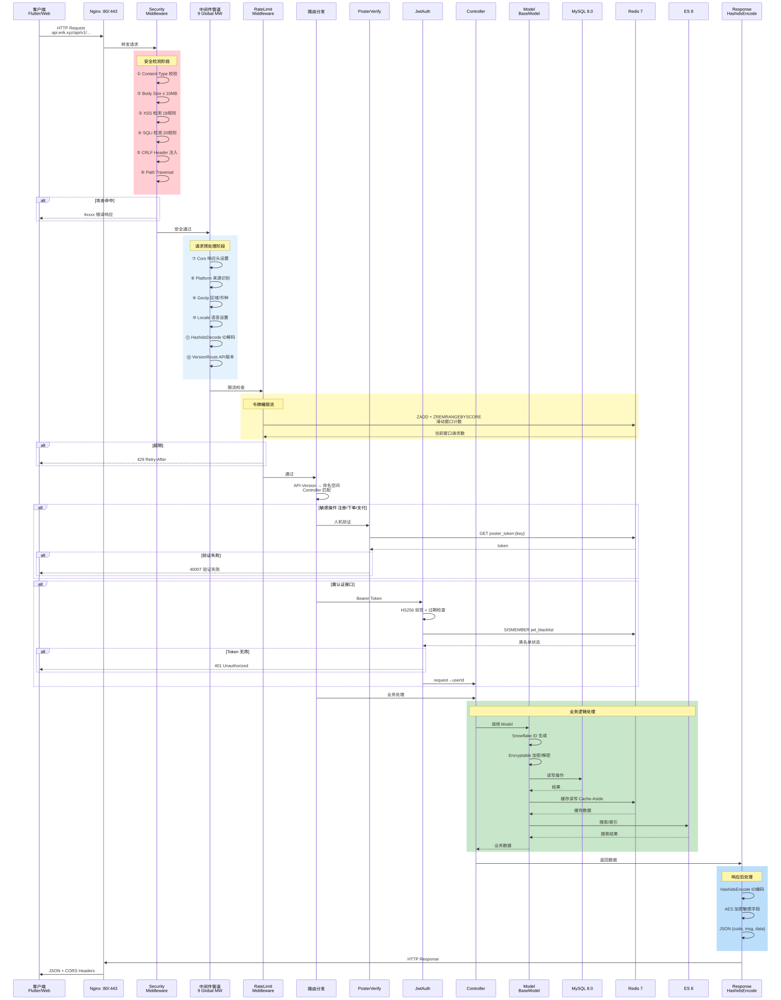

# Erik Shop — 跨境电商平台

Copyright (c) 2026 erik <erik@erik.xyz> — https://erik.xyz

<p align="center">
  
</p>

## 语言 / Languages

| 语言 | 链接 |
|------|------|
| 中文 | [README.md](README.md) |
| English | [docs/README-EN.md](docs/README-EN.md) |

## 项目简介

基于 webman 全家桶构建的全栈跨境电商平台，覆盖 B2C/B2B 场景和第三方卖家入驻。

项目宠物是 **雪球 Snowy** —— 一只头顶雪花冠、身披经纬线的地球精灵，怀抱跨境包裹（详见 [项目宠物](#项目宠物--雪球-snowy)）。

### 技术架构

| 层级 | 技术 | 目录 |
|------|------|------|
| 业务 API | webman + illuminate/database + erikwang2013/* | `service/` |
| 管理后台 | webman-admin + LayUI + ECharts | `admin/` |
| 客户端 | Flutter (iOS/Android/macOS/Windows/Linux) | `apps/flutter/` |

### 技术栈

**服务端：** PHP 8.3+, webman 2.1, MySQL 8.0, Redis 7, Elasticsearch 8
**核心包：** snowflake-php, hashids, jwt-webman, encryption, encryptable, poster-php, webman-scout, season
**支付：** Stripe, PayPal, Klarna, Adyen
**客户端：** Flutter 3.x (Riverpod + GoRouter + Dio)

## 项目宠物 — 雪球 Snowy

<p align="center">
  
</p>

**雪球 Snowy** 是本项目的吉祥物。形象不是随手画的，每一处都对应平台的一项核心设计：

| 造型元素 | 对应设计 | 说明 |
|---------|---------|------|
| ❄ 雪花冠 | Snowflake 分布式 ID | 98 张表全部使用 `erikwang2013/snowflake-php` 生成的 bigint 主键 |
| 🌐 地球身体 | 跨境电商 | B2C/B2B + 第三方卖家入驻，面向全球市场 |
| 经纬线 | 多语言 / 多币种 / 多平台 | 中英文文档、分币种定价、7 平台来源识别 |
| 📦 怀抱包裹 | 国际物流 | 物流分区运费、海外仓、HS 申报、商业发票/装箱单 |
| `#2d8cf0` 主色 | 管理端主题色 | 与 Pear Admin 默认主题色一致 |

### 资源文件

| 文件 | 用途 |
|------|------|
| [docs/pet.svg](docs/pet.svg) | 规范源文件（README 主视觉，256×256，含 CSS 动画） |
| `service/public/pet.svg` | API 服务静态资源 |
| `admin/public/pet.svg` | 管理端静态资源 |
| `service/public/favicon.ico`、`admin/public/favicon.ico` | 浏览器标签页图标（由 pet.svg 生成，多尺寸 64/48/32/16） |

### 代码中的整合点

- **浏览器标签页**：两个站点（`service:8787` / `admin:8788`）的 `favicon.ico` 均替换为雪球，浏览器自动发现，无需额外 `<link>`。
- **管理端登录页**：`admin/plugin/admin/app/view/account/login.html` 顶部渲染雪球形象。
- **README 主视觉**：本文档顶部与本节。

### 复用与修改

单文件 SVG，无脚本、无外部字体、无位图依赖，直接 `` 即可嵌入任意页面。内置 `bob`（浮动）/ `blink`（眨眼）/ `spin`（雪花缓转）三段 CSS 动画，并已适配 `prefers-reduced-motion: reduce`（系统开启「减少动态效果」时自动静止）。

> 修改形象时改 `docs/pet.svg`，然后同步两个副本；favicon 用 `rsvg-convert -w 256 -h 256 docs/pet.svg -o /tmp/pet.png && magick /tmp/pet.png -define icon:auto-resize=64,48,32,16 favicon.ico` 重新生成。


<!-- pet-expressions:start -->
## 项目宠物表情形态 · 雪球 Snowy

<table align="center">
<tr><td align="center"><br><b>笑</b><br><code>:emoji-smile:</code></td><td align="center"><br><b>欢乐</b><br><code>:emoji-joy:</code></td><td align="center"><br><b>哭</b><br><code>:emoji-cry:</code></td><td align="center"><br><b>沮丧</b><br><code>:emoji-depressed:</code></td><td align="center"><br><b>惊恐</b><br><code>:emoji-terrified:</code></td><td align="center"><br><b>愤怒</b><br><code>:emoji-angry:</code></td></tr>
<tr><td align="center"><br><b>撒娇</b><br><code>:emoji-coquettish:</code></td><td align="center"><br><b>卖萌</b><br><code>:emoji-cute:</code></td><td align="center"><br><b>讨好</b><br><code>:emoji-pleasing:</code></td><td align="center"><br><b>敲打</b><br><code>:emoji-knocking:</code></td><td align="center"><br><b>捂脸</b><br><code>:emoji-facepalm:</code></td><td align="center"><br><b>吐舌头</b><br><code>:emoji-tongue:</code></td></tr>
</table>

> 12 种彩色动态形态：笑 / 欢乐 / 哭 / 沮丧 / 惊恐 / 愤怒 / 撒娇 / 卖萌 / 讨好 / 敲打 / 捂脸 / 吐舌头。每个 SVG 自带表情、情绪特效与整体动效，并遵循 `prefers-reduced-motion`。
<!-- pet-expressions:end -->

<!-- assets-license:start -->
## 视觉资产授权 / Visual Assets License

本项目的项目宠物、图片、图标、表情（包括 `docs/pet-expressions/` 等目录下的
SVG / PNG）**不是开源资产**，版权归作者所有。未经书面许可不得复制、修改、再分发或
用于商业用途；商业使用需取得商业授权，联系 **erik@erik.xyz**。详见
[ASSETS-LICENSE.md](ASSETS-LICENSE.md)。

> 代码部分仍遵循仓库原有 `LICENSE`；第三方素材（如明确标注的 Go Gopher 等）仍遵循其原许可证。
<!-- assets-license:end -->


## 架构图集

> 完整图集及大图查看：[docs/diagrams.md](docs/diagrams.md)

### 系统架构图



### 请求处理流程图



### 功能模块全景图



> 功能图涵盖 19 大功能模块（含报表中心、平台统计）。

### 请求生命周期图



### 订单生命周期图



> 更多细节见 [完整架构图集](docs/diagrams.md)（含部署架构、安全架构、多币种结算等 8 张图）

### 安全架构图



### 多币种结算流程图


### 多币种结算说明

**多币种定价**：商品 SKU 按 `currency_code` 分币种定价，下单时订单锁定收款币种（USD / EUR / GBP / CNY 等）。

**汇率服务**：`erik_exchange_rates` 汇率表支持 manual 手动维护与 exchangerate-api 自动拉取，按 `effective_at` 生效时间版本化管理，结算时取支付时点汇率快照。

**原币扣款**：Stripe / PayPal 按订单币种原币扣款（Klarna/Adyen 为占位，未接入），Webhook 验签确认到账后更新支付与订单状态。

**分账结算**：支付成功后自动生成 `PlatformSettlements` 平台分账（订单总额 + 平台佣金 + 支付网关手续费，按订单币种记账）；卖家结算 `MerchantSettlements`（订单金额 → 抽成率 → 结算金额）、供应商结算 `SupplierSettlements` 三线独立结算，状态 0 待结算 / 1 已结算。

**汇兑损益**：`CurrencyExchangeGainsLosses` 追踪收款币种与结算币种差异，对比支付时汇率与结算时汇率，正数 = 汇兑收益、负数 = 汇兑亏损，支撑跨境电商多币种对账与审计。

## 快速开始

### 方式一：Web 一键安装（推荐）

```bash
# 1. 安装 admin 依赖
cd admin && composer install

# 2. 启动管理后台
php start.php start -d

# 3. 浏览器打开安装向导
# http://127.0.0.1:8788/app/admin/install/step1
# 填入数据库信息 → 设置管理员账号 → 完成

# 4. 安装依赖并启动 API
cd ../service && composer install && php start.php start -d
```

> 安装向导自动完成：建库 → 导入 98 张表 → 生成 service/.env 和 admin/.env（含随机密钥） → 创建管理员 → 重载服务

### 方式二：命令行手动安装

详见 [INSTALL.md](docs/INSTALL.md)

### Docker 部署

```bash
# 配置环境变量
cp .env.example .env  # 或设置 DB_PASS / JWT_SECRET 等变量

# 一键启动全部服务
docker-compose up -d
# nginx:80 → service:8787 + admin:8788
# MySQL:3306, Redis:6379, ES:9200
```

详见 [部署文档](docs/deployment.md)

## 使用说明

### 管理后台

浏览器访问 `http://127.0.0.1:8788/app/admin` 登录管理后台（首次使用请通过安装向导创建管理员账号）：

- **仪表盘**：GMV、订单量、用户增长等核心指标一览
- **报表中心**：销售摘要、30 天趋势、TOP 商品、支付方式 / 订单状态分布
- 商品、订单、营销、供应链等模块的日常管理

### API 调用

```bash
# 获取商品列表
curl http://127.0.0.1:8787/api/products \
  -H "API-Version: 2026-05-20" \
  -H "X-Platform: web"

# 起始页平台统计（用户/商品/订单/GMV 总量与今日新增）
curl http://127.0.0.1:8787/
```

> API 版本通过 `API-Version` header 指定（不在 URL 中）；敏感接口需携带 `Authorization: Bearer <token>`（JWT）。

### 客户端

- **Flutter 客户端**：`apps/flutter/`（iOS / Android / macOS / Windows / Linux）

## 项目结构

```
shop-php/
  install.sql       # 一键安装 SQL（98 张表），Web 安装向导自动导入
  service/          PHP 业务 API (webman)      — 40 控制器 + 90 模型 + 14 中间件 + 14 自定义进程
  admin/            管理后台 (webman-admin)    — 71 控制器 + 66 模型 + ECharts 仪表盘 + Web 安装向导
  apps/flutter/     Flutter 客户端             — 6 功能模块 + 12 页面 + 5 语言 + PC 自适应
    lib/features/     auth / home / product / cart / order / profile
  docker/           Docker 部署                — Nginx + PHP + MySQL + Redis + ES
  scripts/          工具脚本                    — e2e / smoke_controllers / check_install_tables
  docs/             设计文档 + 架构图集
    pet.svg           项目宠物「雪球 Snowy」规范源文件
    01-08-*.svg       8 张图：系统架构 / 请求流程 / 功能全景 / 请求生命周期 /
                      订单生命周期 / 部署架构 / 安全架构 / 多币种结算（*.mmd 为 Mermaid 源）
    README-EN.md      英文说明
```

### 运行时目录

| 路径 | 内容 |
|------|------|
| `service/public/`、`admin/public/` | 静态资源根（含 `pet.svg`、`favicon.ico`） |
| `service/app/view/`、`admin/plugin/admin/app/view/` | 视图模板（管理端登录页 / 仪表盘 / 安装向导） |
| `service/app/process/` | 自定义进程与定时任务（汇率、物流轨迹、分账结算、对账、Feed 同步等） |
| `service/database/seeders/` | 种子数据（国家 / HS Code / 汇率 / 物流分区 / 合规分类 / 尺码表 / 风控规则） |
| `service/runtime/`、`admin/runtime/` | 运行时缓存与日志（不纳入版本控制） |

## 功能覆盖

| 维度 | 覆盖内容 |
|------|---------|
| **B2C零售** | 多语言商品、分币种定价、SKU、购物车、订单、支付、退款、退货 |
| **B2B批发** | 阶梯定价(MOQ)、企业认证(税号/营业执照)、询价 |
| **多商家入驻** | 卖家审核、商品审核、分成分账 |
| **跨境合规** | HS Code编码库、关税规则、VAT/IOSS、各国合规标签(FDA/CE/RoHS) |
| **国际物流** | 物流分区运费、海外仓(发货仓+退货仓)、商业发票/装箱单、HS申报（规划中） |
| **支付** | Stripe/PayPal（完整）、Klarna/Adyen（占位）、BNPL先买后付（占位）、3DS验证 |
| **营销** | 优惠券(分区+新老客)、轮播图(区域可见) |
| **供应链** | 供应商评级、采购→质检→入库、库存流水(不可变账本)、调拨 |
| **风控合规** | 规则引擎(旁路打分)、KYC实名、GDPR/CCPA数据请求、Cookie Consent |
| **安全防护** | 31类攻击检测(XSS/SQL注入/XXE/SSRF/CRLF/路径遍历/文件上传/暴力破解/HTTP方法/Host/CORS等) |
| **高并发** | 令牌桶限流、DB读写分离、连接池优化 |
| **CDN内容分发** | Origin-Pull回源(零迁移)、4家提供商(Cloudflare/CloudFront/阿里云/腾讯云)、管理端配置+手动刷新/预热+自动刷新(fail-open)、边缘缓存(expires 7d immutable) |
| **报表分析** | 管理端报表中心：销售摘要、30天趋势、TOP商品、支付方式/订单状态分布 |
| **平台统计** | service 起始页统计：用户/商品/订单/GMV 总量与今日新增 |
| **会员增长** | 积分流水、会员等级权益、降价提醒、订阅周期购 |
| **内容管理** | CMS多语言页面、FAQ、尺码对照表、商品Feed同步 |
| **客服** | FAQ 客服 |
| **基础设施** | Snowflake分布式ID、Hashids接口混淆、JWT认证、AES加密、GeoIP区域识别 |
| **多端覆盖** | Flutter(iOS/Android/macOS/Windows/Linux/iPadOS)+Web Admin |
| **平台追踪** | 7平台来源识别(iOS/iPadOS/macOS/Windows/Linux/Android/Web)+DB记录 |
| **测试** | 见 `.github/workflows/ci.yml` |

## 核心设计

- **Snowflake主键**：98张表全部使用 `erikwang2013/snowflake-php` 生成的bigint ID
- **Hashids接口**：中间件自动编码/解码，控制器无感知
- **Encryptable加密**：email/mobile/address等敏感字段数据库级加密
- **JWT认证**：HS256 + access/refresh 双token自动刷新
- **API版本**：`API-Version` header路由，不在URL中
- **Poster验证**：敏感操作(注册/下单/支付)随机人机验证

## 文档

| 文档 | 说明 |
|------|------|
| [README-EN.md](docs/README-EN.md) | English documentation |
| [INSTALL.md](docs/INSTALL.md) | 安装指南（Web 一键安装 + 手动安装） |
| [AUDIT-REPORT.md](docs/AUDIT-REPORT.md) | 安装系统审查报告 |
| [项目规划](docs/PLAN.md) | 团队产出的分阶段项目规划（4 阶段路线图 + 关键风险 + Quick Wins） |
| [CDN支持方案](docs/PLAN-CDN.md) | CDN 内容分发实现方案（Origin-Pull 回源 + 统一 Provider 抽象 + 4 家提供商） |
| [团队调研明细](docs/PLAN-RESEARCH.md) | 7 领域现状调研：已实现 / 差距 / 风险 / 建议 |
| [功能设计文档](docs/features.md) | 完整功能矩阵、业务流程、状态机 |
| [架构图集](docs/diagrams.md) | 架构图、流程图、功能图、生命周期图、部署图、多币种结算图（8 张图，含 Mermaid 源） |
| [项目宠物 雪球 Snowy](docs/pet.svg) | 吉祥物 SVG 源文件（形象释义、整合点、复用与再生成方式见[项目宠物](#项目宠物--雪球-snowy)） |
| [架构设计文档](docs/architecture-full.md) | 系统架构图、中间件管道、数据架构、安全架构、支付架构 |
| [设计文档](docs/design.md) | 数据库表设计、API规范、安全方案、国际化 |
| [架构文档](docs/architecture.md) | 目录结构、模型继承链、关键包 |
| [API接口文档](docs/api.md) | 71个API端点 (静态文档) |
| [hg/apidoc接口文档](http://localhost:8787/apidoc/) | hg/apidoc自动生成 (6分组: 认证/商品/交易/物流海关/用户营销/运营) |
| [部署文档](docs/deployment.md) | Docker/手动部署、环境变量、运维命令 |


## 开源不易，欢迎支持

| 微信 | 支付宝 |
|:---:|:---:|
|  |  |

## 测试

```bash
make test             # 推荐方式
cd service && DB_USER=qa DB_PASS=qa_pass vendor/bin/phpunit  # service 单元/集成（211 tests / 1000 assertions）
cd admin  && DB_USER=qa DB_PASS=qa_pass vendor/bin/phpunit  # admin（2 tests / 7 assertions）
cd service/tests/api && php run_all.php                      # API 自动化（4 套件 213 项断言）
cd scripts/e2e && SERVICE_BASE=http://127.0.0.1:8787 node ui-e2e.js  # UI E2E（admin + service 页面）

# 依赖安全审计（已知 1 个低危 CVE：CVE-2025-45769 firebase/php-jwt <7.0.0，
# 受 jwt-webman ^6.0 约束无法升级，HS256 对称签名用法不受影响）
composer audit
```

最新全量测试结果见 [docs/test-reports/QA-REPORT-2026-08-27.md](docs/test-reports/QA-REPORT-2026-08-27.md)（截图在 `docs/test-reports/screenshots/`，E2E 明细在 `scripts/e2e/results.json`）。

**已知缺口已全部修复（2026-08-28）**：19 个 admin 页面视图 + ShopExport 数据导出页已实现，E2E 重跑 47 PASS / 0 FAIL / 1 WARN（100%），详见测试报告 §8。

## 开发工具

```bash
make help             # 查看所有命令
make lint             # PHP 语法检查
make check            # phpstan 静态分析
make fix              # php-cs-fixer 代码格式化
```

CI/CD: `.github/workflows/ci.yml` — PHP 8.3/8.4 矩阵测试

## 开源版 vs 商业版

`shop-php` 是可直接运行的开源基础版；商业版与开源版同源代码基线，额外交付营销增长、多平台铺货、内容客服与 HarmonyOS 客户端等能力。两版共用同一套订单、支付、库存、跨境合规与安全底座。

| 维度 | 开源版 | 商业版 |
|------|--------|--------|
| 功能覆盖 | 111 控制器 / 156 模型 / 98 表 / 93 路由；B2C/B2B、多商家、跨境合规、国际物流、支付、优惠券、供应链、库存账本、风控/KYC、CMS、报表 | 128 控制器 / 189 模型 / 119 表 / 106 路由；在开源版全部能力上增加营销增长、多平台铺货、知识库/邮件模板/WebSocket IM、HarmonyOS 客户端 |
| 安全防护 | 20 个中间件：JWT、AdminKey、RBAC、Hashids、字段加密、CORS、GeoIP、限流、Security 攻击检测、平台识别、版本路由；README 标注 31 类攻击检测 | 同一套 20 个中间件与 31 类检测器，未另起安全层；新增后台模块统一走 AdminAuth/AdminPermission/OperationLog/RateLimit 管线 |
| 性能与规模 | webman 常驻，worker=CPU×4；Redis 缓存/限流/队列；Elasticsearch；13 个常驻进程（含汇率、物流、合规、推荐等定时任务） | 同一底座；15 个常驻进程，额外 `chat_ws`（WebSocket IM）与 `platform_order_sync_cron`（平台订单同步） |
| 数据与检索 | 98 张表；MySQL + Elasticsearch；1 个 Searchable 模型；CDN 回源/边缘缓存 | 119 张表（+21 张商业模块表）；同一 MySQL/ES 检索底座；新增营销、IM、铺货、知识库等表 |
| 测试与质量 | 25 个 PHPUnit 测试文件 + 1 个 Flutter 测试；2 个 GitHub Actions 工作流 | 商业版快照未包含 PHPUnit 测试目录，保留 1 个 Flutter 测试与 2 个 CI 工作流；质量证据以同源开源版测试为准，新增模块未附带同等测试 |
| 部署与运维 | Docker Compose 六服务（nginx/service/admin/mysql/redis/ES）+ `/health` 健康检查 + 安装入口 + 运行时监控 | 同一六服务编排、健康检查与安装入口；新增模块随同一镜像/进程部署 |
| 多端与国际化 | Flutter 客户端 + Flutter Web 管理端；服务端/后台各 5 种语言资源；文档仅中英文 | 增加 HarmonyOS ArkTS 客户端与 8 平台来源识别；同样 5 种运行时语言；保留 12 语种文档 |
| 扩展性与二次开发 | 6 个支付网关类（Stripe/PayPal/Klarna/Adyen + 接口/工厂）；B2B/多商家、插件式后台、hg/apidoc API 文档 | 同一支付与 B2B/多商家底座；额外 17 个后台控制器、21 张表覆盖营销、IM、铺货、知识库，适合商业运营二次开发 |
| 授权与商业支持 | 仅限个人学习/研究；商业使用需书面授权；无商业 SLA | 商业授权、交付与支持需联系 **erik@erik.xyz**；LICENSE 与开源版同一份 |
| 适用场景 | 个人学习、研究、原型验证、小规模自建 | 商业部署、跨境零售/多商家运营，需要营销增长、多平台铺货、IM、HarmonyOS 的团队 |

**商业版独有功能**

- 营销增长：秒杀（含活动 SKU）、拼团、分销（推广链接/佣金/提现）、礼品卡、积分规则、AB 测试
- 多平台铺货：Amazon / eBay / Shopee / Lazada / Temu 商品刊登与订单聚合
- 内容与客服：知识库、邮件模板、WebSocket 实时 IM
- 会员运营：积分规则、礼品卡、AB 测试
- 客户端：HarmonyOS ArkTS 客户端
- 数据模型：21 张商业版专有表（AB 测试 3、分销 3、聊天 2、秒杀 2、知识库 2、平台同步 4、礼品卡/拼团/积分规则/运费险/邮件模板各 1）

**开源版保留**：B2C/B2B 零售与批发、多商家入驻、跨境合规、国际物流、Stripe/PayPal 支付（Klarna/Adyen/BNPL 占位）、优惠券、供应链、库存账本、风控/KYC、31 类攻击检测、限流与读写分离、CDN 回源与边缘缓存、报表、会员权益、CMS/FAQ、多语言/多币种、Flutter 多端与 Web 管理端。

**授权说明**：开源版仅限个人学习、研究使用；商业部署、付费服务、SaaS 运营、二次销售等需取得作者书面授权。商业版授权与交付条款请联系 **erik@erik.xyz**。

## 项目授权 / Project License

Copyright (c) 2026 erik <erik@erik.xyz> — https://erik.xyz

- 本项目仅供个人学习、研究使用。
- 未经作者书面授权，禁止任何形式的商业使用（包括但不限于商业部署、付费服务、二次销售、SaaS 运营及以本项目为基础提供商业服务）。
- 商业授权请联系 **erik@erik.xyz**。
- 未经授权的商业使用，作者将在全球范围内依法追究法律责任，并保留终身追责的权利。
- 第三方组件仍遵循其各自原有的许可证；视觉资产适用仓库内的 ASSETS-LICENSE.md（如适用）。

**English:** This project is provided for personal study and research only. Commercial use of any kind requires prior written authorization from the author (erik@erik.xyz). Unauthorized commercial use will be pursued for legal liability worldwide, and the author reserves the right to pursue such liability for life. Third-party components remain under their original licenses; visual assets are governed by ASSETS-LICENSE.md where applicable.
