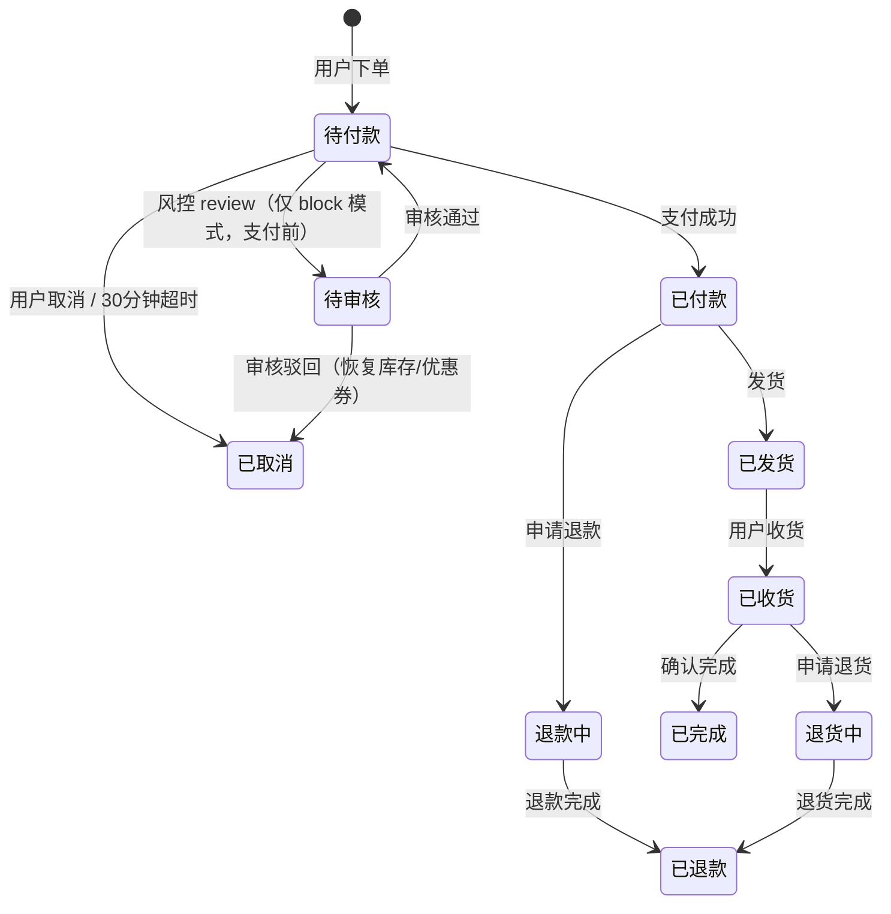
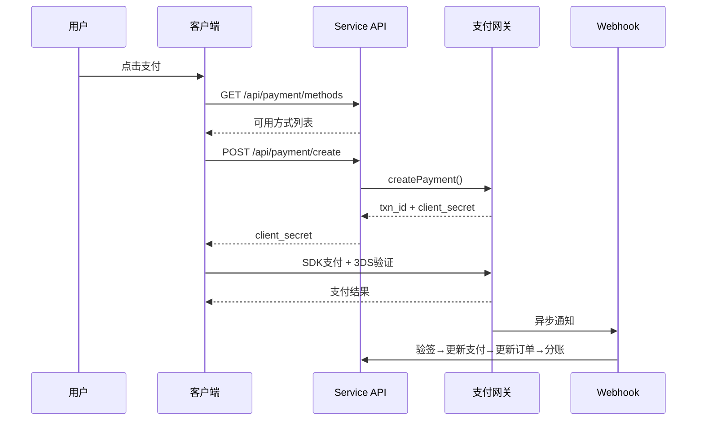
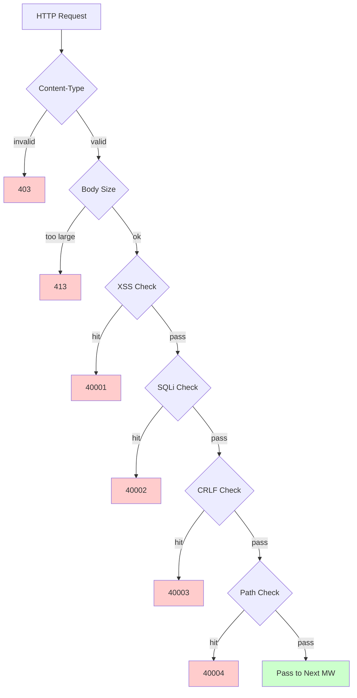

# 跨境电商平台 — 功能设计文档

Copyright (c) 2026 erik <erik@erik.xyz> — https://erik.xyz

---


## 平台追踪

### 8平台识别

| 平台 | Header | Flutter | Admin |
|------|--------|---------|-------|
| iOS | `ios` | Platform.isIOS + TargetPlatform.iOS | UA iPhone |
| iPadOS | `ipados` | Platform.isIOS + !TargetPlatform.iOS | UA iPad |
| macOS | `macos` | Platform.isMacOS | UA Macintosh |
| Windows | `windows` | Platform.isWindows | UA Windows |
| Linux | `linux` | Platform.isLinux | UA Linux |
| Android | `android` | Platform.isAndroid | UA Android |
| HarmonyOS | `harmonyos` | ArkTS 客户端 | UA HarmonyOS |
| Web | `web` | kIsWeb | 默认 |

> UA 匹配顺序：iPad → iPhone → Android → HarmonyOS → Macintosh/Mac OS X → Windows → Linux，避免移动端 UA 中的 `Mac OS X`/`Linux` 误判。

### DB追踪字段

| 表 | 字段 | 说明 |
|----|------|------|
| erik_orders | platform VARCHAR(16) | 下单平台 |
| erik_payments | platform VARCHAR(16) | 支付平台 |
| erik_operation_logs | platform VARCHAR(16) | 操作平台 |
| erik_users | last_login_platform VARCHAR(16) | 登录平台 |
| erik_search_logs | platform VARCHAR(16) | 搜索平台 |

## 1. 功能总览

### 1.0 覆盖总览

| 维度 | 覆盖内容 | 深度 |
|------|---------|------|
| **B2C零售** | 多语言商品、分币种定价、SKU、购物车、订单、30 分钟未付款自动取消、支付(Stripe/PayPal/Klarna)、退款、退货 | 完整 |
| **B2B批发** | 阶梯定价(MOQ)、企业认证(税号/营业执照)、询价 | 完整 |
| **多商家入驻** | 卖家审核、商品审核、分成分账 | 完整 |
| **跨境合规** | HS Code编码库(6位基码)、关税规则(目的国+HS→税率)、VAT/IOSS、合规标签(FDA/CE/RoHS等10类) | 完整 |
| **国际物流** | 物流分区运费(重量阶梯)、DHL/UPS/FedEx/EMS、海外仓(发货+退货)、HS申报(电池/液体标识)、商业发票PDF/装箱单 | 完整 |
| **支付** | Stripe PaymentIntent+3DS、PayPal REST、Klarna BNPL、Adyen、Webhook验签+分账、Webhook/对账统一幂等入账、支付重试复用 client_secret | 完整 |
| **营销** | 优惠券(分区+新老客/品类/商品范围)、轮播图(区域可见) | 完整 |
| **供应链** | 供应商档案+评级、采购单(审核→发货→收货→质检)、质检(入库+出库门禁/外观/功能/合规标签检查)、库存流水(不可变账本:入库/出库/调拨/盘点) | 完整 |
| **风控合规** | 规则引擎(旁路打分:地址校验/邮编匹配/3DS/批量注册/货值异常)、KYC实名、GDPR/CCPA数据请求、Cookie Consent版本管理 | 完整 |
| **安全防护** | SecurityMiddleware 封装 security-php 31个检测器: XSS(13条)/SQL注入(13条)/CRLF/路径遍历(编码+null byte)/Body大小/Content-Type/文件上传/HTTP安全头/暴力破解(Redis计数器)/XXE/SSRF/方法/Host/敏感脱敏/CORS；所有 API 响应 `Cache-Control: no-store`；密码重置 300s/5 次、验证码累计失败 5 次作废 | 完整 |
| **高并发** | 令牌桶限流(滑动窗口+7端点规则)、熔断器(支付/社交登录,5次失败→30s熔断+半开恢复)、DB读写分离(2读副本+sticky)、连接池(DB 50/10+Redis 30/5)、OPCache(128MB, Docker环境) | 完整 |
| **会员增长** | 会员等级+权益、积分流水、降价/到货提醒、收藏夹、商品对比、浏览历史、订阅周期购(地址快照/运费税费/原子扣库存) | 完整 |
| **内容管理** | CMS多语言页面(Landing/Blog)、FAQ多语言、尺码对照表(服装/鞋类+US/UK/EU/JP/CN转换)、商品Feed(Google/Meta+定时同步) | 完整 |
| **基础设施** | Snowflake分布式ID(bigint非自增)、Hashids接口ID混淆、JWT认证(HS256+access/refresh双token刷新)、AES加解密(接口+数据库三层加密)、GeoIP区域识别(MaxMind)、Poster人机验证(滑块/拼图/点击)、CDN内容分发(Origin-Pull回源+边缘缓存+自动刷新) | 完整 |
| **报表分析** | 管理端报表中心(ShopReportController)：销售摘要(GMV/订单数/客单价)、30天趋势、TOP商品、支付方式分布、订单状态分布 | 完整 |
| **平台统计** | service 起始页(GET /)平台统计：用户/商品/订单/GMV 总量与今日新增(StatsController，Redis 缓存 60s) | 完整 |
| **多端覆盖** | Flutter 5平台(iOS/Android/macOS/Windows/Linux/iPadOS) + Web Admin(LayUI+ECharts) + API | Flutter 12页面,Admin 61视图 |
| **平台追踪** | 8平台识别(iOS/iPadOS/macOS/Windows/Linux/Android/HarmonyOS/Web)+X-Platform header+5表记录(orders/payments/operation_logs/users/search_logs) | 完整 |
| **测试** | 见 `.github/workflows/ci.yml` | CI 覆盖 |

### 1.1 模块矩阵

| 一级模块 | 二级模块 | 优先级 | 状态 |
|---------|---------|--------|------|
| 用户系统 | 注册/登录/社交登录/KYC实名/地址/收藏/会员/积分 | P0-P2 | ✅ |
| 商品系统 | 分类/SKU/多语言/多币种/图片/属性/合规/HS Code/ES搜索/Feed | P0-P1 | ✅ |
| 交易系统 | 购物车/订单/支付(Stripe+PayPal+Klarna)/退款/退货/发票 | P0 | ✅ |
| 物流系统 | 国际物流商/分区运费/海外仓/发货(HS申报)/物流保险 | P0-P1 | ✅ |
| 海关税务 | HS Code库/关税规则/VAT/IOSS/各国合规限制 | P0 | ✅ |
| 营销系统 | 优惠券/轮播图 | P1-P2 | ✅ |
| 供应链 | 供应商/采购单/质检/库存流水 | P1 | ✅ |
| 风控合规 | 规则引擎/GDPR/CCPA/Cookie Consent/平台追踪 | P1 | ✅ |
| 安全防护 | XSS/SQL注入/CRLF/路径遍历/Content-Type/请求体 | P0 | ✅ |
| 多商家 | 第三方卖家入驻/店铺/商品/结算 | P2 | ✅ |
| 内容管理 | CMS/FAQ/通知/尺码表 | P2 | ✅ |
| 增长工具 | B2B批发/订阅周期购 | P2-P3 | ✅ |
| 基础设施 | Snowflake ID/JWT/Hashids/Encryption/Poster/API版本/GeoIP/CDN内容分发 | P0 | ✅ |
| 报表中心 | 销售摘要/30天趋势/TOP商品/支付方式/订单状态分布 | P1 | ✅ |
| 平台统计 | service 起始页 用户/商品/订单/GMV 统计 | P1 | ✅ |

---

## 2. 核心业务流程图

### 2.1 订单状态机



> 风控默认 `risk.mode=bypass`，只打分写日志，不改变订单状态；仅 `mode=block` 且结果为 `review` 时进入待审核（status=8）。待审核发生在支付前，审核通过回到待付款，驳回进入已取消。

### 2.2 支付时序



### 2.3 安全检测管道



---

## 3. 核心业务流程

### 3.1 用户注册登录

```
EMAIL注册: email+password → PosterVerify人机验证 → bcrypt(password+salt)
          → Snowflake生成ID → 返回 JWT {access_token, expires_in}

社交登录: Google/Apple/Facebook OAuth → 验证id_token
        → erik_user_social_accounts 查绑定
        → 已绑定:登录 / 未绑定:自动创建用户+绑定 → 返回JWT

登录: email+password → password_verify(password+salt)
    → 更新last_login_at/ip/platform → 签发JWT

Token刷新: refresh_token → Jwt::decode → 新access_token
```

### 3.2 商品浏览与搜索

```
列表: GET /api/products
  → 筛选: category_id/status/keyword/price_range
  → 排序: default/price_asc/price_desc/sales/newest
  → 多语言: ProductTranslations 按 locale 过滤
  → 分币种: ProductSkuPrices 按 currency_code 匹配
  → 分页: 20条/页

ES搜索: GET /api/search?keyword=xxx
  → Erikwang2013\WebmanScout\Searchable → ES多语言分析器
  → 聚合: category/price/brand
  → 降级: ES不可用时MySQL LIKE

详情: GET /api/products/{hashid}
  → HashidsDecode中间件解码 → Eager Load
  → 多语言+分币种+合规+HS Code+尺码转换+含/不含税+VAT
```

### 3.3 购物车与下单

```
购物车: POST /api/cart {sku_id, quantity}
  → 校验SKU存在|上架|库存充足
  → 同SKU累加 / 不存在则创建

下单: POST /api/orders {address_id, coupon_id, currency_code, remark?, weight_grams?}
  → 1.校验收货地址/禁售国家/KYC
  → 2.事务内 lockForUpdate 读取已选购物车行（用户级防重锁）
  → 3.逐商品校验: SKU.status=1 且 product.status=2；库存条件扣减；写库存流水
  → 4.必须有请求币种报价（缺失 422「该币种暂无报价」，不回退 CNY default_price）
  → 5.计算优惠券: countries(ISO2) + scope_type(all/category/product) + scope_ids
       折扣与 min_amount 均按适用商品小计
  → 6.服务端重量 = Σ(product.weight × quantity)，克，向上取整；
       总重<=0 时才回退 weight_grams
  → 7.OrderPricing 计算运费/税费（税费阈值按整单）
  → 8.创建Order+OrderItems → 9.核销优惠券 → 10.写OrderLog
  → 11.风控打分（默认 bypass 只记录；block+review 才置 status=8）
  → 12.只删除本次锁到的购物车行

取消: POST /api/orders/{id}/cancel
  → 仅 status=0 可取消 → OrderCancellation 原子状态门闩
  → 恢复库存 + 库存流水 + 退还优惠券（回退 Coupons.used_qty）+ OrderLog
  → status=5

超时: UnpaidOrderCron 每 5 分钟扫描创建超过 30 分钟的待付款订单
  → 与用户取消共用 OrderCancellation
  → 跳过已有进行中网关支付（payments.status=0 且 transaction_no != ''）的订单
```

### 3.4 支付流程

```
可用方式: GET /api/payment/methods?country=DE&currency=EUR
  → PaymentGatewayMethods(按country+currency过滤)

创建支付: POST /api/payment/create
  → 分布式锁(TTL 120s/等待 5s)；锁超时 429，系统异常 500(不暴露内部信息)
  → PaymentGateway::make(gateway)→createPayment()
  → Stripe: PaymentIntent → client_secret 存入 payments.gateway_data
  → 重试同一订单复用待支付单，返回已存 client_secret，不重复创建网关单

Webhook: POST /webhook/payment/{gateway}
  → 验签 → PaymentSuccessService::apply()（与 PaymentReconcileCron 共用）
     → 订单 0→1、支付 0→1（原子门闩，重复回调幂等）
     → PlatformSettlements + 商品/SKU sales_count 累加
  → 网关成功但订单已取消/已退款：写 warning 日志供人工核对

结算: SettlementCron
  → whereNotExists + chunkById(500) 扫描所有未结算已付款订单（无 500 单/天上限）
  → 每笔订单一个事务：锁订单行 + 复查 PlatformSettlements
  → 平台/卖家/供应商分账原子提交
```

### 3.5 退货流程

```
申请: POST /api/returns {order_id, reason_id}
  → 判断退货通道: 当地仓(type=1)/退回国内(type=2)/仅退款(type=3)

审核: Admin审核 → 通过:生成ReturnLabel / 驳回:写原因

寄回: 下载面单→寄回→物流更新→仓库收货→status=已收货

退款: status=已完成 → 关联Refund → PaymentGateway::refund→原路退回
```

### 3.6 关税估算

```
GET /api/tariff/estimate?product_id=xxx&dest_country_id=xxx&declared_value=100

1. ProductHsCodes → HsCode
2. TariffRules(dest_country_id + hs_code_id) → duty_rate
3. VatSettings(country_id) → vat_rate + duty_free_threshold + vat_free_threshold
4. 整单判断（下单/订阅使用 OrderPricing）:
   consignment = Σ 商品申报价值
   duty = consignment >= duty_free_threshold
          ? Σ(各商品价值 × 对应 HS duty_rate / 100) : 0
   vatBase = consignment + duty
   vat = vatBase >= vat_free_threshold ? vatBase × vat_rate / 100 : 0
5. return {duty_rate, vat_rate, estimated_duty, estimated_vat, estimated_total, hs_code, disclaimer}
```

> `/api/tariff/estimate` 用于单商品试算；实际下单与订阅按整单/整包裹一次性判断免税阈值。

### 3.7 订阅周期购

```
创建: POST /api/subscriptions {sku_id, address_id, interval_days: 30|60|90, quantity?}
  → address_id 必填且属于当前用户
  → 用户级锁 + 事务创建订阅
  → SubscriptionOrderService 生成首期待付款订单:
     USD 分币种报价必须存在（不回退 default_price）
     SKU.status=1、product.status=2
     原子扣库存 + 库存流水 + 商品重量/运费/税费 + 地址快照
  → 返回 subscription_id/order_id/first_amount（含运费税费的实付金额）

列表: GET /api/subscriptions
取消: POST /api/subscriptions/{id}/cancel（仅 active；与续费订阅行锁互斥）

续费: SubscriptionCron
  → 复用最近一期订阅订单的地址快照
  → 无报价/下架/库存不足 → 暂停订阅并写日志
```

---

## 4. 安全防护 (SecurityMiddleware 封装 security-php 31个检测器)

### 4.1 检测规则总表

| # | 攻击类型 | 主要检测方式 | 错误码 | Service | Admin |
|---|---------|------------|--------|---------|-------|
| 1 | XSS跨站脚本 | 13条正则: script/iframe/on事件/svg+on/style/expression/javascript:/embed/object/link/meta | 40001 | ✅ | ✅ |
| 2 | SQL注入 | 13条正则: UNION SELECT/SELECT FROM WHERE/sleep/benchmark/pg_sleep/布尔型/字符串型/注释符/MySQL特殊注释/schema枚举/load_file/into outfile/存储过程/waitfor/delay | 40002 | ✅ | ✅ |
| 3 | CRLF Header注入 | `[\r\n]` in: Authorization/X-Platform/API-Version/X-Forwarded-For/Referer/Origin | 40003 | ✅ | ✅ |
| 4 | 路径遍历 | `../` + `%2e%2f`编码 + `%252e%252f`二层编码 + null byte `\0` + `.env`/`.git`/`phpmyadmin`/`wp-admin`/`/etc/`/`/proc/`/`composer.json` | 40004 | ✅ | ✅ |
| 5 | 请求体限制 | Content-Length > 10MB(Service) / 20MB(Admin) | 40005 | ✅ | ✅ |
| 6 | Content-Type限制 | 仅JSON/form-data/form-urlencoded | 40006 | ✅ | ✅ |
| 7 | **文件上传校验** | 黑名单扩展名(php/phtml/sh/exe/js/...)+双重扩展名攻击+空扩展名 | 40009 | ✅ | ✅ |
| 8 | **HTTP安全响应头** | nosniff/DENY/XSS-Protection/Referrer-Policy/Permissions-Policy/Cache-Control/Server隐藏 | — | ✅ | ✅ |
| 9 | **暴力破解防护** | Redis计数器: API 10次/60s, Admin 5次/300s | 40008 | ✅ | ✅ |
| 10 | **XXE实体注入** | `<!ENTITY SYSTEM>`, `<!DOCTYPE [` | 40010 | ✅ | ✅ |
| 11 | **SSRF服务器伪造** | 内网IP(127/10/172.16/192.168/0.0/169.254.169.254)+localhost+metadata.google.internal | 40011 | ✅ | ✅ |
| 12 | **HTTP方法校验** | 仅 GET/POST/PUT/DELETE/PATCH/OPTIONS/HEAD | 40012 | ✅ | ✅ |
| 13 | **Host头校验** | 拒绝裸IP直接访问 | 40013 | ✅ | — |
| 14 | **敏感数据脱敏** | 日志/错误响应过滤password/token/secret | — | ✅ | ✅ |
| 15 | **CORS白名单** | 可配置origin限制 | — | ⚠️ | ⚠️ |

### 4.2 中间件管道

```
Service 全局 (10): Cors → Security → RateLimit → Platform → GeoIp → Locale
                 → HashidsDecode → VersionRoute → HashidsEncode → Encryption
Service 路由级 (2): PosterVerify / JwtAuth（按接口配置）

Admin: Security → Platform → HashidsDecode → AccessControl → HashidsEncode
```

响应安全：所有 service API 响应统一 `Cache-Control: no-store, no-cache, must-revalidate`。密码重置申请/确认限流 300s/5 次；确认接口按邮箱累计失败 5 次作废验证码（Redis TTL 1800s），重新申请验证码会清零失败计数。

### 4.3 平台来源追踪

| 平台 | Header值 | 识别方式 |
|------|---------|---------|
| iOS | `ios` | Flutter `Platform.isIOS` |
| iPadOS | `ipados` | Flutter `TargetPlatform.iOS` 判断 |
| macOS | `macos` | Flutter `Platform.isMacOS` |
| Windows | `windows` | Flutter `Platform.isWindows` |
| Linux | `linux` | Flutter `Platform.isLinux` |
| Android | `android` | Flutter `Platform.isAndroid` |
| HarmonyOS | `harmonyos` | ArkTS 客户端 Header / UA `HarmonyOS` |
| Web | `web` | UA 降级 / 默认 |

---


## 5. 高并发与性能

### 5.1 限流规则

| 端点 | 算法 | 窗口 | 限制 |
|------|------|------|------|
| /api/auth/login | 滑动窗口 | 60s | 10次 |
| /api/auth/password/reset | 滑动窗口 | 300s | 5次 |
| /api/auth/register | 滑动窗口 | 300s | 5次 |
| /api/auth/social | 滑动窗口 | 300s | 5次 |
| /api/payment | 滑动窗口 | 60s | 5次 |
| /api/orders | 滑动窗口 | 10s | 3次 |
| /api/search | 滑动窗口 | 1s | 10次 |
| 默认 | 滑动窗口 | 60s | 100次 |

共 7 条端点规则，其余路径走默认规则。

### 5.2 Redis 用途

| 用途 | 实现 |
|------|------|
| 限流令牌桶 | Redis ZSET 滑动窗口 |
| 人机验证 | PosterVerify 验证码状态 |
| Session 存储 | Redis KV 存储 |

业务数据不做应用层缓存，直接读取 MySQL（读写分离 + 连接池）。

### 5.3 连接池

| 资源 | 最大 | 最小 | 超时 |
|------|------|------|------|
| MySQL | 50 | 10 | 2s |
| Redis | 30 | 5 | — |

## 6. 数据表关系图

```
erik_users ──┬── addresses, social_accounts, wishlists, kyc
             ├── carts, orders → order_items → payments
             ├── reviews, coupons(through user_coupons)
             ├── notifications, subscriptions, point_logs
             ├── b2b_verifications
             └── privacy_requests

erik_products ──┬── translations(product_id, locale)
                ├── skus → sku_prices(sku_id, currency_code)
                ├── images, reviews, compliance → compliance_categories
                ├── hs_codes → hs_codes, recommendations
                ├── b2b_prices, platform_listings
                └── product_comparisons

erik_orders ──┬── order_items, order_logs
              ├── payments, refunds, return_orders → return_labels
              ├── order_documents, shipments
              ├── platform_settlements, risk_logs
              └── subscription_orders

erik_countries ──┬── vat_settings, tariff_rules(dest_country_id)
                 ├── country_compliance_rules
                 ├── shipping_zones(JSON countries)
                 └── warehouses(country_id)
```

---

## 7. API接口

完整的 API 端点列表（公开接口 23 个 + 认证接口 49 个 + Webhook + Admin/Health），详见 [API接口文档](api.md)。

---

## 8. 测试验证

### 8.1 2026-10-30 修复轮

- `service/tests` 共 6 个文件：49 个单元测试 / 110 断言，本地通过（`vendor/bin/phpunit tests/Unit`，无需 DB）
- 3 组集成测试（`OrderCancellation`、`PaymentSuccessService`、`OrderPricing`）依赖 MySQL schema，本地未运行，由 CI（PHP 8.3/8.4 矩阵）执行
- CI 同时运行 admin PHPUnit、PHPStan、控制器 smoke check 与 Flutter analyze/test

```bash
cd service && vendor/bin/phpunit tests/Unit            # 49 tests / 110 assertions
cd service && DB_USER=qa DB_PASS=qa_pass vendor/bin/phpunit  # 含 3 组集成测试（需 MySQL schema）
```

### 8.2 历史基线（2026-08-27，5 人测试团队）

见 [docs/test-reports/QA-REPORT-2026-08-27.md](test-reports/QA-REPORT-2026-08-27.md)：
service 单元/集成 **211 tests / 1000 assertions** ✅、admin 2/7 ✅、API 自动化 **4 套件 213 项断言** ✅、UI E2E **26 PASS / 21 FAIL / 1 WARN** ⚠️。

已知缺口已于 2026-08-28 全部实现：19 个 admin 页面视图 + ShopExport 导出页，E2E 重跑 47 PASS / 0 FAIL / 1 WARN（100%），详见报告 §8。

```bash
cd service && DB_USER=qa DB_PASS=qa_pass vendor/bin/phpunit
cd service/tests/api && php run_all.php
cd scripts/e2e && SERVICE_BASE=http://127.0.0.1:8787 node ui-e2e.js
```

### 8.3 核心测试套件（历史基线）

| 测试类 | Tests | 覆盖 |
|--------|-------|------|
| SecurityTest | 12 | XSS(3条)+SQLi(2条)+XXE(2条)+SSRF(1条)+Path(2条)+信用卡泄漏(1条)+正常放行(1条) |
| JwtTest | 4 | encode三段式JWT + decode往返 + 无效token→null + 空token→null |
| ApiResponseTest | 3 | success(code=0) + fail(error code) + paginate(list+meta分页) |
| RedisFacadeTest | 3 | ping + set/get往返 + redis() 辅助函数（Redis 不可用时 skip） |
